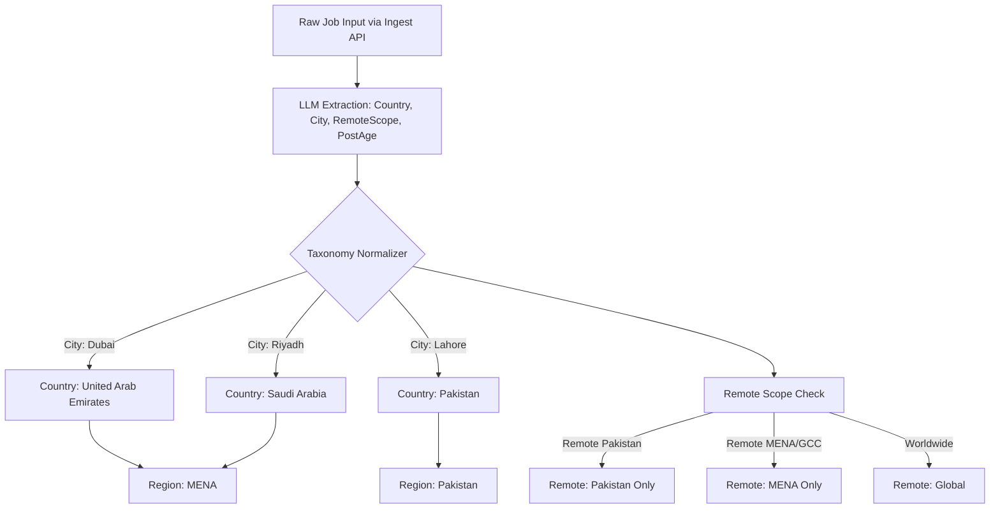
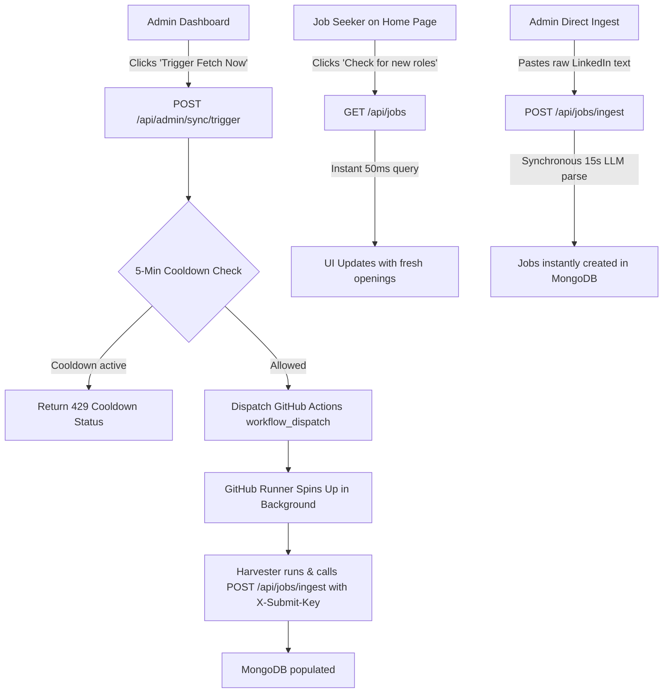

# MENA & Pakistan Expansion: Architectural Plan & System Audit

## Executive Summary

This document outlines the architectural plan to scale the **JobCapture** search engine from a local job board (Lahore/Pakistan) into a regional tech job search engine covering **Pakistan and the MENA region** (UAE, Saudi Arabia, Egypt, Qatar, Kuwait, Bahrain, Oman). 

The goal is to capture **Onsite, Hybrid, and Remote** tech roles—specifically focusing on **AI/ML, Software Engineering, DevOps, Cloud, IT & Technical Support, and adjacent disciplines**—while eliminating old/stale jobs, prompt hallucinations, and data-modeling bottlenecks, backed by an intuitive, high-performance frontend UI/UX.

---

## 1. Architectural Teardown & Roast of Current Approach

### 1.1 The Volume vs. Manual Ingestion Bottleneck
- **Current State:** The backend relies on text submitted via `POST /api/jobs/ingest` (either manually or via submitter scripts).
- **The Reality:** While Lahore produces tens of posts per week, the MENA tech market (Dubai, Abu Dhabi, Riyadh, Jeddah, Cairo, Doha) produces **thousands of tech openings daily**.
- **Decision:** While automated harvesters/crawlers would be ideal long-term, building and maintaining web scrapers against LinkedIn/Google is currently **not feasible** (IP bans, bot walls, high maintenance). We will continue using the **Intelligent Parser & Storage API model** via `POST /api/jobs/ingest` and focus entirely on making the taxonomy, prompt parsing, data modeling, and frontend filtering rock-solid.

### 1.2 The "Area / Neighborhood" Fallacy
- **The Pitch:** *"Append job filters by location by city by area basically."*
- **The Roast:** Filtering by sub-neighborhood ("area" like *DHA Phase 5*, *Business Bay*, *Maadi*, *KAFD*) is classic over-engineering (YAGNI). 
  - LinkedIn posts rarely standardize micro-locations.
  - Tech candidates in Dubai or Riyadh commute across the metro or work hybrid.
  - More critically: **The current codebase doesn't even have a `country` field!**
- **The Real Need:** A hierarchical taxonomy:
  $$\text{Region (MENA / Pakistan / Global)} \longrightarrow \text{Country} \longrightarrow \text{City} \longrightarrow \text{Workplace Type (Remote / Hybrid / Onsite)}$$

### 1.3 Why Old / Stale Jobs Keep Appearing
The appearance of expired and outdated roles is directly caused by instructions in the current prompt engineering:
1. **Explicit Timestamp Discard:** In `src/prompts/ingestPrompt.js:L4-6`, the prompt explicitly states:
   > *"relative timestamps such as '2d' or '3h'... Ignore all of that noise — it is not part of the post content."*
   The model is commanded to ignore the single indicator of job age!
2. **Artificial Timestamping:** MongoDB sets `createdAt: new Date()` upon ingestion. A post from 4 months ago copied today is marked as brand new.
3. **No Staleness Gate:** There is zero logic in `ingestController.js` to reject posts older than 14 or 30 days.

### 1.4 Hallucinations & Information Loss via Paraphrasing
In `src/prompts/ingestPrompt.js:L56-59`:
> *"description: a REWRITTEN description... in your own words — do not copy sentences verbatim..."*
- **Why this fails:**
  - Token consumption increases by 300%–500% per LLM call.
  - The model frequently drops strict regional constraints (e.g., *"Must possess valid UAE residency / NOC"*, *"Saudi National only due to Saudization / Nitaqat"*).
  - The model may invent or shift required experience levels.

### 1.5 The Recruiter Duplicate Collision Bug
In `src/services/jobService.js:L19-27`:
- Duplicate detection matches `company + jobTitle`.
- When a post is from an external recruiter (very common in MENA), `company` falls back to the recruiter's personal name.
- Any subsequent "Backend Engineer" role posted by that same recruiter is permanently rejected as a duplicate, even if it is for a completely different client company.

---

## 2. Taxonomy & Data Modeling Blueprint



### 2.1 Regional & Geographic Taxonomy (`src/taxonomy/locations.js`)

Replace the flat, unindexed `KNOWN_CITIES` array with a structured Country $\rightarrow$ City hierarchy:

```javascript
const REGIONS = {
  PAKISTAN: 'Pakistan',
  MENA: 'MENA',
  GLOBAL: 'Global',
};

const GEOGRAPHY = {
  'Pakistan': {
    region: REGIONS.PAKISTAN,
    flag: '🇵🇰',
    cities: [
      'Lahore', 'Karachi', 'Islamabad', 'Rawalpindi', 'Faisalabad',
      'Multan', 'Peshawar', 'Quetta', 'Sialkot', 'Gujranwala', 'Hyderabad'
    ],
    aliases: ['pk', 'pak', 'pakistan']
  },
  'United Arab Emirates': {
    region: REGIONS.MENA,
    flag: '🇦🇪',
    cities: ['Dubai', 'Abu Dhabi', 'Sharjah', 'Ajman', 'Ras Al Khaimah', 'Fujairah', 'Al Ain'],
    aliases: ['uae', 'united arab emirates', 'emirates']
  },
  'Saudi Arabia': {
    region: REGIONS.MENA,
    flag: '🇸🇦',
    cities: ['Riyadh', 'Jeddah', 'Dammam', 'Khobar', 'Dhahran', 'Mecca', 'Medina', 'Jubail'],
    aliases: ['ksa', 'saudi', 'saudi arabia', 'kingdom of saudi arabia']
  },
  'Egypt': {
    region: REGIONS.MENA,
    flag: '🇪🇬',
    cities: ['Cairo', 'Giza', 'Alexandria', 'New Cairo', '6th of October', 'Nasr City', 'Maadi'],
    aliases: ['egypt', 'are']
  },
  'Qatar': {
    region: REGIONS.MENA,
    flag: '🇶🇦',
    cities: ['Doha', 'Lusail', 'Al Rayyan'],
    aliases: ['qatar']
  },
  'Kuwait': {
    region: REGIONS.MENA,
    flag: '🇰🇼',
    cities: ['Kuwait City', 'Hawally', 'Salmiya'],
    aliases: ['kuwait']
  },
  'Bahrain': {
    region: REGIONS.MENA,
    flag: '🇧🇭',
    cities: ['Manama', 'Riffa', 'Muharraq'],
    aliases: ['bahrain']
  },
  'Oman': {
    region: REGIONS.MENA,
    flag: '🇴🇲',
    cities: ['Muscat', 'Salalah', 'Sohar'],
    aliases: ['oman']
  }
};
```

### 2.2 Workplace Type & Remote Scope Hierarchy
A flat `"remote"` flag is insufficient. The schema differentiates:
- **`workplaceType`**: `'onsite' | 'hybrid' | 'remote'`
- **`remoteScope`**:
  - `'Pakistan'` (remote, but candidate must reside in Pakistan)
  - `'MENA'` / `'GCC'` (remote, but candidate must reside within MENA/GCC timezone)
  - `'Worldwide'` (true global remote)
  - `'Country Specific'` (e.g., remote within UAE only)

### 2.3 Tech Discipline & Skills Expansion
The current categories in `src/taxonomy/categories.js` already contain strong foundations (`AI / ML Engineering`, `DevOps & Cloud`, `Software Engineering`, `Technical Support`). 

To align with the MENA tech market, enrich `src/taxonomy/skills.js` with:
- **AI & ML:** `MLOps`, `vLLM`, `Ollama`, `Arabic NLP`, `Hugging Face`, `LangGraph`, `DSPy`, `Vector Databases`.
- **Cloud & DevOps:** `Oracle Cloud (OCI)` (heavily adopted in Saudi/UAE enterprise), `Azure DevOps`, `Kubernetes`, `Terraform`, `FinOps`.
- **Enterprise & FinTech:** `Tap Payments`, `HyperPay`, `Fawry`, `Mada`, `Telco APIs`, `Core Banking Integration`.
- **Support & Systems:** `ITIL`, `ServiceNow`, `Jira Service Management`, `L1/L2/L3 Application Support`.

---

## 3. Ingest Prompt Engineering Redesign

### 3.1 Eliminating Old Roles & Hallucinations
Update `src/prompts/ingestPrompt.js` with the following rules:

```text
POST FRESHNESS & TIMESTAMPS:
- Extract the relative post timestamp from the UI noise if visible (e.g., "2h", "1d", "5d", "2w", "1mo", "3mo").
- If the post explicitly indicates it is older than 30 days (e.g. ">30d", "2mo", "3mo", or an expired deadline), mark "isStale": true.
- If the post is recent (within 30 days) or no timestamp is detected, mark "isStale": false and supply "relativeAge" (e.g. "3d").

LOCATION RULES:
- "country": The primary country where this role is legally located or hired into (e.g., "United Arab Emirates", "Saudi Arabia", "Pakistan", "Egypt"). If it is a global remote role with no country restriction, set to null.
- "cities": Array of city names only (e.g., ["Dubai"], ["Riyadh"]). Never put countries or neighborhoods here.
- "remoteType": "remote" | "hybrid" | "onsite" | null.
- "remoteScope": If remote, specify the geographical restriction stated ("Worldwide", "MENA only", "Pakistan only", "UAE only", or null).

DESCRIPTION INTEGRITY:
- Do NOT rewrite or summarize the job description in your own words.
- Clean up OCR and UI artifacts, but preserve the exact requirements, responsibilities, salary, and visa/nationality stipulations verbatim.
```

### 3.2 Target Output JSON Shape
```json
{
  "is_job_post": true,
  "isStale": false,
  "relativeAge": "2d",
  "company": "Careem",
  "isCompanyNameFallback": false,
  "contactEmail": "recruitment@careem.com",
  "applicationLink": "https://careers.careem.com/jobs/123",
  "posterName": null,
  "jobs": [
    {
      "jobTitle": "Senior AI / MLOps Engineer",
      "categories": ["AI / ML Engineering", "DevOps & Cloud"],
      "skills": ["Python", "Kubernetes", "PyTorch", "Docker", "MLOps"],
      "unknownSkills": ["vLLM"],
      "experienceYears": 4,
      "country": "United Arab Emirates",
      "cities": ["Dubai"],
      "remoteType": "hybrid",
      "remoteScope": null,
      "description": "Full verbatim requirements..."
    }
  ]
}
```

---

## 4. Database Schema & Query Enhancements

### 4.1 Schema Updates (`src/models/Job.js`)

```javascript
// Additions to Job Schema
country: { type: String, default: null, index: true },
region: { type: String, enum: ['Pakistan', 'MENA', 'Global', 'Other', null], default: null, index: true },
remoteScope: { type: String, default: null },
postedAt: { type: Date, default: null, index: true }, // Inferred from relativeAge
isStale: { type: Boolean, default: false },

// Compound indexes for fast multi-tenant/regional filtering
jobSchema.index({ region: 1, country: 1, cities: 1 });
jobSchema.index({ remoteType: 1, remoteScope: 1 });
jobSchema.index({ status: 1, postedAt: -1 });
```

### 4.2 Public Filter & Facets Updates (`src/controllers/publicJobsController.js`)

- **Query Parameters Added:**
  - `?region=MENA`
  - `?countries=United Arab Emirates,Saudi Arabia`
  - `?cities=Dubai,Riyadh`
  - `?remoteScope=Pakistan,Worldwide`
- **Facets API Response Enriched:**
  ```json
  {
    "total": 420,
    "regions": { "Pakistan": 220, "MENA": 180, "Global": 20 },
    "countries": [
      { "name": "Pakistan", "count": 220 },
      { "name": "United Arab Emirates", "count": 110 },
      { "name": "Saudi Arabia", "count": 70 }
    ],
    "cities": [
      { "name": "Dubai", "country": "United Arab Emirates", "count": 95 },
      { "name": "Riyadh", "country": "Saudi Arabia", "count": 65 },
      { "name": "Lahore", "country": "Pakistan", "count": 140 }
    ]
  }
  ```

---

## 5. Architectural Decision: Intelligent Parser & Storage API (Harvester Deferred)

### 5.1 Why We Are Skipping the Harvester
Automated web scraping against platforms like LinkedIn, Indeed, and Google Jobs involves:
1. Frequent IP bans and CAPTCHA walls requiring expensive rotating proxy services.
2. Fragile HTML selectors that break on third-party UI tweaks.
3. High memory consumption (500MB+ per headless browser instance).

**Decision:** We are **skipping the automated harvester** in this phase as it is not currently feasible or necessary. 

### 5.2 The Solidified Model
We double down on the **Intelligent Parser & Storage API model**:
- Ingestion occurs via the robust `POST /api/jobs/ingest` endpoint.
- Submissions can be sent with an Admin JWT or via the companion `X-Submit-Key`.
- The backend handles LLM parsing (Gemini via OpenRouter), taxonomy enforcement, deduplication, and indexed storage.
- Any future automation or scraping tools can simply POST payloads to this same endpoint without altering backend logic.

---

## 6. Frontend Architectural & UI/UX Redesign

Scaling to MENA + Pakistan directly impacts the React frontend (`frontend/src`). Here is the component-by-component redesign to support regional scale with premium UI/UX.

### 6.1 Frontend Flaws & UX Roasts in Current Code
1. **The Massive Flat City Checklist (`FilterBar.jsx`):**
   - Currently, `FilterBar.jsx:L36-41` takes `facets?.cities` and dumps all cities into a single alphabetical checklist.
   - At MENA scale (50+ cities), users in Cairo must scroll past *Abu Dhabi, Ajman, Alexandria, Dammam, Doha, Dubai, Faisalabad, Giza, Islamabad, Jeddah, Karachi, Lahore, Riyadh...* to find local roles.
   - "Not specified" is pinned at the top, grouping Pakistan-remote, MENA-remote, and unclassified roles into one confusing bucket.
2. **The "Just Now" Timestamp Lie (`JobCard.jsx:L50` & `JobModal.jsx:L38`):**
   - The UI displays `{relativeTime(job.createdAt)}` and `{formatDate(job.createdAt)}`.
   - If a post was created 3 weeks ago on LinkedIn but ingested 10 minutes ago, the candidate sees **"Just now"**. This erodes user trust immediately when they discover the position is closed.
3. **No Geographic Anchor on Job Cards:**
   - Cards display only `city`. A remote role open to Pakistan or UAE has no country badge, leaving candidates guessing whether they are legally eligible before opening the modal.
4. **URL & State Sync Blindspots (`filtersUrl.js` & `useJobs.js`):**
   - `LIST_KEYS` lacks `countries`, `region`, and `remoteScope`. If a user filters by UAE and refreshes or shares the URL, their filter is lost.

---

### 6.2 The UI/UX Component Specifications

#### A. Dual-Tier Cascading Location Filter (`FilterBar.jsx`)
Replace the flat city list with a structured **Country $\rightarrow$ City selector**:
- **Country Level:** Select countries with national flags and live counts:
  - 🇵🇰 Pakistan `(145)`
  - 🇦🇪 United Arab Emirates `(88)`
  - 🇸🇦 Saudi Arabia `(54)`
  - 🇪🇬 Egypt `(32)`
  - 🇶🇦 Qatar `(18)`
- **City Level (Cascading & Searchable):**
  - If a country is checked, the City section dynamically filters to show only cities within that country.
  - If no country is selected, cities are grouped under collapsible country headers.
  - Includes quick search for rapid typing (e.g., typing "Dub" jumps to Dubai).

#### B. Dedicated Remote Scope Controls (`FilterBar.jsx`)
In the "Work type" section:
- Base options: `Remote`, `Hybrid`, `Onsite`.
- When `Remote` is checked, a conditional secondary pill bar appears:
  - `Any Remote` | `Remote (Pakistan only)` | `Remote (MENA only)` | `Worldwide Remote`

#### C. Rich Geo & Freshness Badges on Job Cards (`JobCard.jsx`)
```jsx
// Enriched Card Header:
<div className="job-meta">
  {job.country && (
    <span className="job-meta-item is-country">
      {getCountryFlag(job.country)} {job.cities?.[0] ? `${job.cities[0]}, ` : ''}{job.country}
    </span>
  )}
  {job.remoteType && (
    <span className="tag" data-kind={job.remoteType}>
      {job.remoteScope ? `Remote (${job.remoteScope})` : capitalize(job.remoteType)}
    </span>
  )}
  <span className="job-time" title={job.postedAt ? `Original post: ${formatDate(job.postedAt)}` : ''}>
    {relativeTime(job.postedAt || job.createdAt)}
  </span>
</div>
```

#### D. Comprehensive Job Detail Modal (`JobModal.jsx`)
The modal facts bar displays complete geographic & workplace terms:
- **Location:** City, Country (Flag), Region (e.g., `Dubai, United Arab Emirates (MENA)`).
- **Work Model:** `Hybrid (3 days office, 2 days remote)` or `Full Remote`.
- **Eligibility / Visa:** `Candidate must reside in UAE / NOC required` (preserved verbatim from post).
- **Date Posted:** Displays **Original Post Date** (`postedAt`) with secondary note for ingestion date.

#### E. Active Filter Chips (`ActiveFilters.jsx`)
Displays distinct, clear chips:
- `🇵🇰 Pakistan` `[×]`
- `🇦🇪 UAE` `[×]`
- `City: Dubai` `[×]`
- `Remote: MENA only` `[×]`

#### F. URL & State Synchronization (`filtersUrl.js` & `constants.js`)
Expand `LIST_KEYS` and `EMPTY_FILTERS`:
```javascript
export const EMPTY_FILTERS = {
  search: '',
  track: '',
  region: '',
  countries: [],
  cities: [],
  remoteType: [],
  remoteScope: [],
  categories: [],
  skills: [],
  skillsMatch: 'any',
  experience: [],
};

const LIST_KEYS = ['countries', 'cities', 'remoteType', 'remoteScope', 'categories', 'skills', 'experience'];
```

#### G. Mobile Drawer UX Best Practices
- **Sticky Bottom Action Bar:** On mobile screens, the open filter drawer displays a fixed bottom bar:
  `[ Clear All ]` --- `[ Show 42 Roles ]`
- **Zero Layout Shift:** Instant optimistic count updates so the user knows how many jobs match before closing the drawer.

---

## 7. Local Environment Setup & Configuration Guide

To run the project locally after plan implementation, configure the environment files for both Backend and Frontend.

### 7.1 Backend Environment Configuration
Create a file at `JobCapture-Backend/.env`:

```env
# Server Port
PORT=3000

# MongoDB Connection String (Local Mongo or Atlas)
MONGODB_URI=mongodb://localhost:27017/job-board

# JWT Auth Secret (generate with: node -e "console.log(require('crypto').randomBytes(32).toString('hex'))")
JWT_SECRET=your-secure-jwt-secret-string-here
JWT_EXPIRES_IN=7d

# OpenRouter Configuration for Gemini structuring
OPENROUTER_API_KEY=sk-or-v1-your-openrouter-key-here
LLM_MODEL=google/gemini-2.5-flash-lite

# Admin Login Credentials (checked in memory against auth routes)
ADMIN_EMAIL=admin@example.com
ADMIN_PASSWORD=your-secure-admin-password

# Submitter Shared Key (for mobile companion app or external ingest scripts)
# Generate with: node -e "console.log(require('crypto').randomBytes(24).toString('base64url'))"
SUBMIT_API_KEY=your-random-submit-key-here
```

### 7.2 Frontend Environment Configuration
Create a file at `JobCapture-Backend/frontend/.env`:

```env
# Backend Base API URL (no trailing slash)
VITE_API_BASE_URL=http://localhost:3000
```

### 7.3 Step-by-Step Local Execution Commands

1. **Start Backend Server:**
   ```bash
   cd "c:\Users\This PC\JobCapture-Backend"
   npm install
   npm run dev    # Starts Express with nodemon on http://localhost:3000
   ```
   *Health Check:* `curl http://localhost:3000/api/health` $\rightarrow$ `{"error":false,"message":"ok"}`

2. **Start Frontend Dev Server:**
   ```bash
   cd "c:\Users\This PC\JobCapture-Backend\frontend"
   npm install
   npm run dev    # Starts Vite dev server on http://localhost:5173
   ```

---

## 8. Implementation Checklist & Verification

- [ ] **Environment Setup:** Configure `.env` in Backend and `frontend/.env`.
- [ ] **Taxonomy Expansion:** Create `src/taxonomy/locations.js` mapping Countries <-> Cities <-> Regions with flags.
- [ ] **Prompt Update:** Update `src/prompts/taxonomyBlock.js` and `ingestPrompt.js` to extract `country`, `postAge`, `isStale`, and preserve verbatim descriptions.
- [ ] **Schema Migration:** Add `country`, `region`, `remoteScope`, and `postedAt` fields to `src/models/Job.js`.
- [ ] **Ingest Logic:** Enforce staleness rejection (>30 days) and prevent recruiter-name duplicate collisions in `ingestController.js`.
- [ ] **API & Facet Updates:** Update `publicJobsController.js` to filter and aggregate on `countries`, `region`, and `remoteScope`.
- [ ] **Frontend State & URL:** Update `filtersUrl.js`, `constants.js`, and `jobsApi.js` to handle `countries` and `remoteScope`.
- [ ] **Frontend FilterBar:** Implement country-first cascading selector with flags and remote scope pills.
- [x] **Frontend Cards & Modals:** Render `postedAt`, country flags, and explicit remote eligibility badges.
- [x] **Backfill Script:** Update `src/scripts/reclassifyJobs.js` to infer and backfill `country` and `region` for existing jobs.

---

## 9. On-Demand Population ("Fetch Now") vs. Scheduled Actions Cron

### 9.1 The Architectural Roast: Why a Naive "Fetch Now" Button is a Trap
1. **The Phantom Engine Problem:** Triggering a "Fetch Now" before writing an actual reliable scraper is putting an ignition switch on an empty engine bay. Scraping LinkedIn without an authenticated headless browser or proxy pool hits Cloudflare/Authwall walls instantly.
2. **The LLM Denial of Service (DoS):** LLM structuring via OpenRouter free tier takes 15–20 seconds per post. If random visitors on the public homepage can click "Fetch New Jobs", 5 visitors clicking simultaneously will exhaust rate limits and hang server threads.
3. **HTTP Gateway Timeouts:** Serverless hosts (Vercel, AWS Lambda) enforce 10–15s hard execution timeouts. Scraping 20 jobs and structuring them through an LLM takes 3–5 minutes. A synchronous HTTP "Fetch Now" request will fail with 504 Gateway Timeout every single time.
4. **GitHub Actions Dispatch Lag:** GitHub Actions runners take 30–90 seconds just to spin up an Ubuntu container, checkout the repo, and install packages. "Fetch Now" cannot be instantaneous.

### 9.2 The Production-Grade "Fetch Now" Solution


### 9.3 Components Delivered
1. **Admin Trigger API (`POST /api/admin/sync/trigger`):**
   - 5-minute debounce gate protects against spam.
   - Automatically fires GitHub's `workflow_dispatch` API if `GITHUB_TOKEN` & `GITHUB_REPO` are present.
   - Live status endpoint (`GET /api/admin/sync/status`) returns remaining cooldown seconds.
2. **Admin UI (`Fetch & Ingest` tab):**
   - Displays runner status and cooldown.
   - Provides a "Structure & Ingest Now" live text parsing box for instant job entry.
3. **GitHub Actions Workflow (`.github/workflows/job-sync.yml`):**
   - Scheduled cron (`0 */6 * * *`) + manual `workflow_dispatch` trigger.
4. **Public Board Refresh:**
   - Non-blocking "Check for new roles" button on the active results bar.
