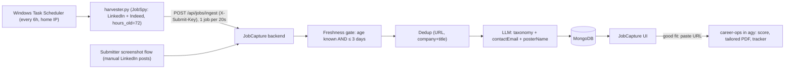

# JobCapture: build plan (reviewed against the code)

Goal: every few hours, get **fresh (≤ 3 days)** tech jobs for Pakistan + GCC into JobCapture, with
contact leads pulled out, then tailor a CV only for the jobs worth applying to.

---

## 1. What changed after review

| Old plan item | Verdict | Why |
|---|---|---|
| "Change `STALE_CUTOFF_DAYS` to 3" (one line) | **Not enough** | The gate lets posts through when their age is unknown. `parsePostAge(null)` returns `isStale: false`, and then `postedAt = new Date()` marks an undated post as fresh. The 30-day rule is also written into the LLM prompt and the tests. |
| New `/api/jobs/ingest-batch` endpoint | **Cut** | `/api/jobs/ingest` already dedups, classifies into your taxonomy and pulls out leads. The harvester can send each job there with a `Posted Nd ago` line. You get no new endpoint and no second code path. |
| Switch to free Gemini (AI Studio) | **Cut for now** | The paid `gemini-2.5-flash-lite` on OpenRouter costs about $0.10 per 1M input tokens. 100 jobs/day × ~3k tokens comes to roughly **$1/month**. Rewriting `llmClient.js` to save that isn't worth it. Revisit if the bill ever matters. |
| SERP dorking for LinkedIn posts | **Spike only, not v1** | The Bing Search API is retired. Scripted Google searches get CAPTCHAs. DuckDuckGo has no 3-day filter. Search engines often index a post days later, which kills the ≤ 3-day goal. Untested. |
| 1-click bookmarklet on LinkedIn | **Cut** | LinkedIn's CSP (`connect-src`) blocks a bookmarklet's `fetch` to your API. You already have a manual path: the submitter screenshot flow into `/ingest`. |
| In-app "Tailor CV" + `my_profile.json` | **Replace with career-ops** | career-ops already scores fit (1–5), writes a tailored PDF, drafts form answers and keeps a tracker. It runs in `agy`, which you already have. Building this into the app would put your personal CV next to a public API (`cors()` is open). |
| Made-up stats (30–40% reply rate, banned in 48h, 1,500 apps in 4h, 15 RPM) | **Removed** | Unsourced. They don't belong in a build plan. |

---

## 2. The v1 pipeline



---

## 3. Build steps

### Step 1: freshness gate that fails closed (~10 lines)
- [postAge.js](file:///c:/Users/This%20PC/JobCapture-Backend/src/utils/postAge.js): `STALE_CUTOFF_DAYS = 3`. Update the header comment.
- [ingestController.js](file:///c:/Users/This%20PC/JobCapture-Backend/src/controllers/ingestController.js#L42-L47): reject when `ageInfo.ageDays === null` (unknown age), not only when stale. Update the "30 days" messages.
- [ingestPrompt.js](file:///c:/Users/This%20PC/JobCapture-Backend/src/prompts/ingestPrompt.js#L14): change "older than 30 days" to "older than 3 days".
- [postAge.test.js](file:///c:/Users/This%20PC/JobCapture-Backend/tests/postAge.test.js): `'2w'` is now stale, and the "> 30 days" test becomes "> 3 days". Keep `'3d'` as not stale.

> [!WARNING]
> Failing closed means manual screenshots **without** a visible "2d"/"5h" timestamp get rejected.
> That's on purpose: "fresh" is the whole point. If it hurts, let admins bypass it later.

### Step 2: `scripts/harvester.py` (~60 lines)
- `pip install python-jobspy requests`
- Loop over a short list: `search_term` × `location` (Karachi, Lahore, Islamabad, Dubai, Abu Dhabi, Riyadh, Doha).
- `scrape_jobs(site_name=["linkedin","indeed"], hours_old=72, linkedin_fetch_description=True, country_indeed=...)`.
  - LinkedIn: `hours_old` can't be combined with `easy_apply`. Indeed: it can't be combined with `job_type`/`is_remote`. Use `hours_old` only.
- Per row, build `rawText`:
  ```text
  Posted {days}d ago
  {title}
  {company} | {location}
  {job_url}

  {description}
  ```
  Send it to `/api/jobs/ingest` with `sourceUrl = job_url` and the `X-Submit-Key` header.
- Treat `409` (duplicate) and `422` (stale / not a job) as normal and log other errors.
- Wait 20 s between posts. The submitter rate limit is 30 requests per 10 minutes ([jobsRoutes.js](file:///c:/Users/This%20PC/JobCapture-Backend/src/routes/jobsRoutes.js#L10)).
- One self-check: assert that the `rawText` builder outputs a `Posted Nd ago` line `parsePostAge` can read.
- Schedule: Task Scheduler runs `python scripts\harvester.py` every 6h.

### Step 3: tailoring with career-ops (0 lines in this repo)
- `npx @santifer/career-ops init` in a **separate** folder, outside this repo.
- Onboard once (CV, target roles, salary, location).
- For any JobCapture job you like, run `/career-ops auto-pipeline <url>` in `agy`. You get a score, a report, a tailored PDF and a tracker row.
- Jobs with a `contactEmail`: send the tailored PDF plus a short email straight to the poster. That's the edge over people applying through the ATS.

### Later (only if v1 proves the need)
- An admin "Copy cold email" button in the UI when `contactEmail` is present.
- Delete or rewire [job-sync.yml](file:///c:/Users/This%20PC/JobCapture-Backend/.github/workflows/job-sync.yml). It still only runs `echo`, and LinkedIn blocks GitHub's datacenter IPs more than your home IP.
- A SERP-dorking spike, if you can show LinkedIn posts that JobSpy misses and that get indexed within 3 days.

---

## 4. Known limits
- JobSpy can break when LinkedIn or Indeed change their HTML. Pin the version and expect fixes now and then.
- `linkedin_fetch_description` adds about 1 s per job.
- Indeed's `date_posted` is a date, not a time, so "≤ 3 days" is accurate to about a day.
